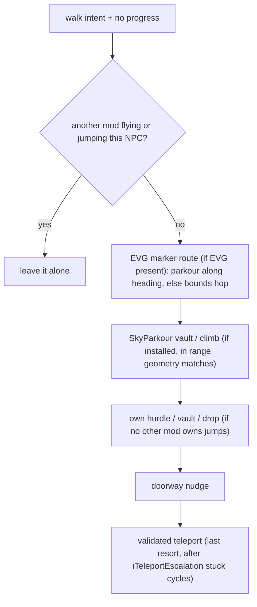

<div align="center">


[](https://github.com/SenjuWoo/Modern-NPC-Pathing/actions/workflows/build.yml)
[](https://github.com/SenjuWoo/Modern-NPC-Pathing/releases/latest)
[](#requirements)
[](BUILDING.md)
[](LICENSE)

**[Install](#install)** · **[Compatibility](#compatibility)** · **[Settings](#settings)** · **[How it works](#how-it-works)** · **[Performance](#performance)** · **[Build](#build)** · **[Honest status](#honest-status)** · **[Changelog](CHANGELOG.md)** · **[Nexus](https://www.nexusmods.com/skyrimspecialedition/mods/185413)**

</div>

# NPC Pathing NG v3.0.2

Skyrim NPCs freeze against geometry, doorframes, fences and short ledges that the navmesh does not cover. NPC Pathing NG is an SKSE plugin for Skyrim SE/AE (one DLL, built on CommonLibSSE-NG v14.1.0) that watches for **walk intent with no progress**, then tries escapes in order of how natural they look: an EVG marker route, a SkyParkour vault or climb, its own hurdle/vault/drop, a doorway nudge, and finally a short, checked teleport. When Fluid Motion or NpcTraversalNG is installed, it lets them go first.

It is not a pathfinding rewrite and not a combat-AI overhaul.

## What you get

- Stuck detection that ignores idle, sandboxing, sitting, swimming, mounted and in-dialogue NPCs
- **Own hurdle / vault / drop (new in 3.0):** a stuck humanoid goes over a fence, up onto a ledge or down toward its goal along a collision-checked arc with the vanilla jump animations. No animation files, no SkyParkour needed
- Optional **SkyParkour** vault/climb when that mod is installed
- **Follower replay** of your recent SkyParkour moves and EVG marker crossings
- **EVG Animated Traversal markers as routes** (optional; never furniture activation)
- Doorway handling that does not shove NPCs sideways off the only route
- Validated last-resort teleport after repeated stuck cycles against static geometry
- A **compatibility layer** for Fluid Motion and NpcTraversalNG ([below](#compatibility))
- MCM via MCM Helper, with `Data/SKSE/Plugins/NPCPathingNG.ini` as fallback
- **One short FOMOD**: the mod detects what is installed when the game starts; the installer has a single page and one optional tick-box (StepUpOnto patch)


## Install

Install the single FOMOD from [Releases](https://github.com/SenjuWoo/Modern-NPC-Pathing/releases) or [Nexus](https://www.nexusmods.com/skyrimspecialedition/mods/185413) with Mod Organizer 2 or Vortex. One page, press Install.

- Always installed: plugin, SEQ, MCM config, INI, DLL
- Optional tick-box, off by default: the SkyParkour-aware StepUpOnto SKSE build. Tick it only if you use StepUpOnto SKSE with SkyParkour; it replaces StepUpOnto's DLL

Upgrading from 2.x: install over it. ESP globals and FormIDs from 2.4.6-2.5.0 are unchanged; three globals were added (`0x814-0x816`), which is safe on an existing save (they are not in the save yet and take their INI-seeded value). The old three-option FOMOD profiles map to settings: *Navmesh failsafe only* = `bEnableParkour=0` and `bEnableEVGTraversal=0`; *SkyParkour only* = `bEnableEVGTraversal=0`.

### Requirements

**Hard**

- Skyrim SE (1.5.97) or AE (1.6.x / 1.7.x)
- SKSE64
- Address Library for SKSE Plugins

**Optional**

- [SkyParkour V3](https://www.nexusmods.com/skyrimspecialedition/mods/132292) plus its Nemesis/Pandora behavior patch
- SkyUI + MCM Helper (INI works without them)
- EVG Animated Traversal
- Fluid Motion and/or NpcTraversalNG: detected, never required

`NPCPathingNG.esp` is ESL-flagged. No full load-order slot. The DLL uses the static runtime: no Visual C++ Redistributable needed.

## Compatibility

The DLL looks for the other NPC-traversal mods once, after every plugin has loaded, so load order does not matter and none of them is a dependency.

| Detected | What this mod does |
| --- | --- |
| **NpcTraversalNG** ("Enemies Can Jump and Vault", `NpcTraversal.dll`) | Reads its `NPCT_ActiveFlights` export: never touches an NPC it is flying; keeps its own leap off; waits twice as long before stepping in; teleport needs 2 more stuck cycles |
| **Fluid Motion** (`FluidMotion.dll`, plus `FluidMotionAnimation.dll`) | No typed API exists, so its own INI is read (`[FluidMotion] bEnabled`, `[Jump] bEnabled`, `[NpcClimb] bClimb`) and re-read on every load. Same rules as above while its jumps/climbs are on; a body that is in the air is never treated as stuck |
| **FluidMotionNPC** (tonycubed2, `FMNPC_*` API) | `FMNPC_IsTraversing` is honoured, and `FMNPC_Claim` is called while this mod's SkyParkour or leap moves an NPC so the two never fight over a body |
| **SkyParkour V3**, **EVG Animated Traversal** | Used as before (graph variables and form lookups) |
| **StepUpOnto SKSE** | Tick the optional patch in the installer to get the SkyParkour-aware build of its DLL (a mod manager cannot detect StepUpOnto, so this one is your choice) |
| *None of the above* | This mod does the hurdle/vault/drop itself |

Override in the MCM (**Compatibility** page) or the INI (`[Compat] sMode`):

- **Auto** (default): as above
- **Force**: ignore the other mods and always run this mod's own traversal (can double-handle an NPC)
- **Passive**: never run the own leap; parkour, EVG hop and teleport only as a late fallback

The log (`NPCPathingNG.log`) prints one `compat:` line at game start listing exactly what was found and the resulting decision.

## Settings

| | |
| --- | --- |
| MCM | **NPC Pathing NG** (pages: General, Parkour, Compatibility, Followers & Combat) |
| INI | `Data/SKSE/Plugins/NPCPathingNG.ini` (re-read when you close the journal) |
| Log | `Documents/My Games/Skyrim Special Edition/SKSE/NPCPathingNG.log` |

The INI seeds the MCM at `kDataLoaded` (before a save loads). Loading an existing save restores that save's MCM values. MCM changes apply instantly.

The keys you are most likely to touch (defaults as shipped):

| Want | INI key (section) | Default |
| --- | --- | --- |
| Turn the whole mod off | `bEnabled` (`[General]`) | `1` |
| Let other traversal mods go first, or not | `sMode` (`[Compat]`): `Auto`, `Force`, `Passive` | `Auto` |
| Own hurdle / vault / drop | `bEnableLeap` (`[Leap]`) | `1` |
| SkyParkour climbs, and how high | `bEnableParkour`, `fMaxClimbHeight` (`[Parkour]`) | `1`, `130.0` (60-250) |
| Parkour and leaps indoors | `iIndoorMode` (`[Parkour]`) | `0` (off) |
| EVG marker routes | `bEnableEVGTraversal` (`[Parkour]`) | `1` |
| Followers copy your parkour and EVG moves | `bFollowerReplay` (`[Followers]`) | `1` |
| Last-resort teleport, and after how many stuck cycles | `bEnableTeleportFallback`, `iTeleportEscalation` (`[Avoidance]`) | `1`, `5` |
| Frame-time cap for the plugin's own work | `fFrameBudgetMs` (`[Performance]`) | `0.6` ms |
| Ignore NPCs farther than this from you | `fProcessRadius` (`[Performance]`) | `4500.0` units |
| Per-minute cost line in the log | `bDebugLogging` (`[Debug]`) | `0` |

Every key is commented in the shipped INI.

## How it works



Each step is tried only when the previous one does not apply or fails. The same ladder as plain text:

```text
walk intent + no progress   (other mod flying/jumping this NPC? -> leave it alone)
    -> EVG marker route (if EVG present): parkour along heading, else bounds hop
    -> SkyParkour vault/climb (if installed, in range, geometry matches)
    -> own hurdle / vault / drop (if no other mod owns jumps)
    -> doorway nudge
    -> validated teleport (last resort, after iTeleportEscalation stuck cycles)
```

## Performance

3.0 is built around not spending frame time:

- Detection is cheap and sampled; the expensive part (ledge sweeps, leap planning) goes into a **queue** that runs at most two attempts per frame and only while a **time budget** (default 0.6 ms, MCM-adjustable) lasts. A crowd of stuck NPCs can no longer produce a frame spike
- NPCs farther than 4500 units from you are not watched
- MCM globals are copied a few times a second, not every frame
- Follower replay is throttled (each try was a full ledge sweep every 0.25 s per follower)
- EVG markers are collected **once per cell**; the old code walked every reference of every nearby cell for each stuck NPC
- Graph variable and event names are interned once instead of rebuilt per call
- With `bDebugLogging=1` (or any heavy work happening) the log prints a per-minute line: average and worst frame cost, rays cast, attempts run and deferred

I measured none of this in game (see [Honest status](#honest-status)); the per-minute line is there so you can.

## What this mod does not claim

- **Not a full AI overhaul.**
- **Default climb height is 130 units.** Raise toward 250 in MCM/INI for higher climbs.
- **The own leap is humanoid-only** (it relies on the humanoid jump events). Creatures, brutes and many-legged climbs are NpcTraversalNG's territory, not duplicated here.
- **Indoor parkour and leaps are off by default.** Teleport fallback can still clear stuck NPCs indoors.
- **SkyParkour climb SFX are 2D**: parkour fires only within **1600** units of the player.
- **NPCs never enter EVG furniture** (`ActivateRef` / Papyrus `Activate` are engine-rejected for NPCs).

## Build

Windows x64, Visual Studio 2022 or 2026 (Desktop C++), CMake 3.25+, Python 3.10+, vcpkg, and [CommonLibSSE-NG](https://github.com/alandtse/CommonLibSSE-NG) **v14.1.0**. Full recipe: [`BUILDING.md`](BUILDING.md).

```powershell
./build_release.ps1
```

Game-independent checks that need no vcpkg, no CommonLib and no game:

```powershell
python generate_esp.py                    # regenerate the ESL-flagged ESP and SEQ
python -m unittest discover -s tests -v   # release, ESP, MCM, FOMOD and version checks
tools\run_unit_tests.bat                  # arc solver unit tests (MSVC only)
```

CI (`.github/workflows/build.yml`) runs all of these, checks that the regenerated ESP and SEQ match the committed ones, builds the plugin and the StepUpOnto patch against the pinned CommonLibSSE-NG commit, confirms the DLL embeds the project version, and uploads the verified FOMOD.

Do not distribute `build/`, `extern/`, vcpkg packages, object files, PDBs, nested `.git` directories, or old ZIP files.

### Project map

```text
src/                 SKSE plugin (pathing, leap, compat, parkour, EVG routes, settings)
src/arc.h            game-independent arc solver (unit-tested)
tests/               unit tests and release/ESP/version checks (not in-game)
package/             staged Data tree (ESP, INI, SEQ, MCM)
fomod_src/           FOMOD installer sources (one automatic installer)
patches/             StepUpOnto SKSE compatibility patch sources
tools/               FOMOD / release packagers, unit-test runner
generate_esp.py      ESL-flagged ESP generator
build_release.ps1    one-command build, test and package
```

## Honest status

Verified in this tree:

- Version **3.0.2** across `VERSION.txt`, CMake (the DLL takes it from there), vcpkg manifest, FOMOD, ESP
- The plugin compiles with `/W4` and no warnings (the StepUpOnto patch keeps its upstream warning level) against CommonLibSSE-NG v14.1.0 (SE + AE + VR layouts), static runtime
- Arc solver unit tests, Python release/ESP/MCM/FOMOD tests, FOMOD archive verification (member allowlist, payload hashes, both install branches simulated)
- The `NPCT_ActiveFlights` signature and the `FMNPC_*` API were read from the NpcTraversalNG and Fluid Motion sources; the installed `NpcTraversal.dll` exports `NPCT_ActiveFlights` (checked on its export table)

**Not verified (no gameplay run happened):**

- Runtime behaviour on any game version: the leap, the compat arbitration and the frame cost are untested in game. The 3.0.2 DLL has been seen to load under Skyrim 1.6.1170 (its log reaches `NPCPathingNG loaded`), and nothing past start-up was observed
- FluidMotion.dll 1.2 exports `FluidMotion_GetAPI`, which has no public header, so it is not called; its ownership comes from its INI
- Address Library IDs were not independently checked per runtime; they come from CommonLibSSE-NG v14.1.0

If a new build crashes on load, roll back to 2.5.0 and send `NPCPathingNG.log`.

## Related: StepUpOnto SKSE

[StepUpOnto SKSE](https://www.nexusmods.com/skyrimspecialedition/mods/175689) by TheShinyHaxorus can fire its step-warp in the middle of a SkyParkour move. The FOMOD ships a build that checks `SkyParkourOngoing` first (patch sources: [`patches/StepUpOntoSKSE-V2`](patches/StepUpOntoSKSE-V2)). It is an optional tick-box in the installer (managers cannot detect a DLL-only mod).

## Contributing

Issues and pull requests are welcome; see [CONTRIBUTING.md](CONTRIBUTING.md). The game-independent checks above must pass, and CI must build the plugin. Bug reports need `NPCPathingNG.log`.

## Credits

SkyParkour V3 by Waffuru (graph events / `SkyParkourOngoing`). Fluid Motion by megakuutti, FluidMotionNPC by tonycubed2 and NpcTraversalNG by NyrQ (all GPL-3.0; their published APIs and ideas informed the compatibility layer, no code is copied). EVG Animated Traversal. MCM Helper. [CommonLibSSE-NG](https://github.com/alandtse/CommonLibSSE-NG) (alandtse, from the CharmedBaryon / powerof3 lineage). Address Library (meh321). SKSE team.

## License

[GPL-3.0](LICENSE). Full release history in [CHANGELOG.md](CHANGELOG.md).
